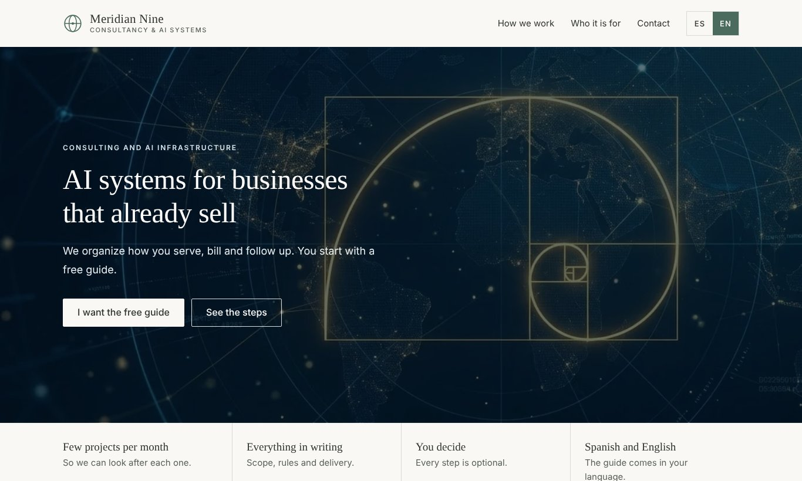
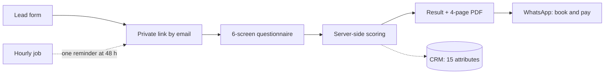
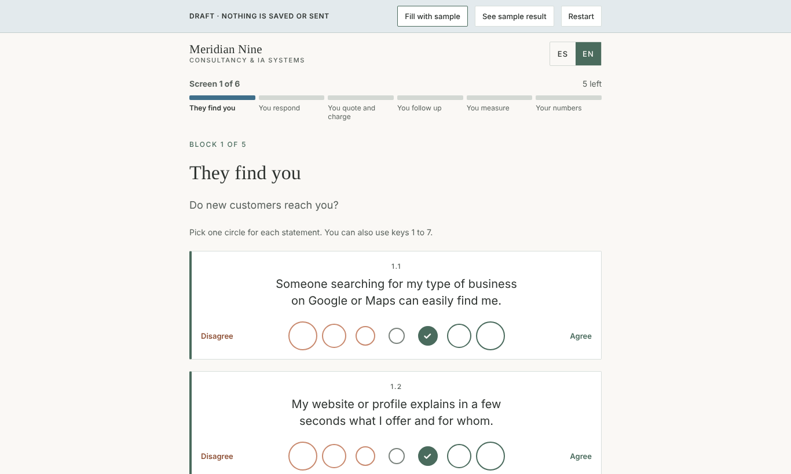
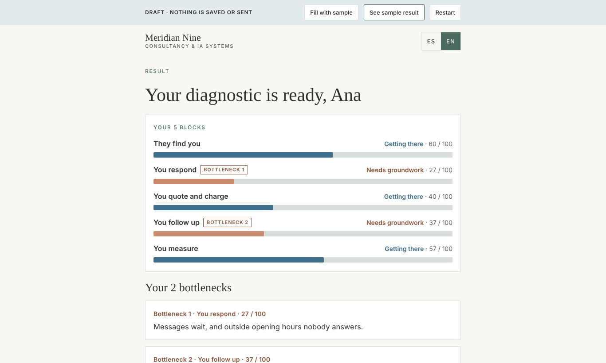
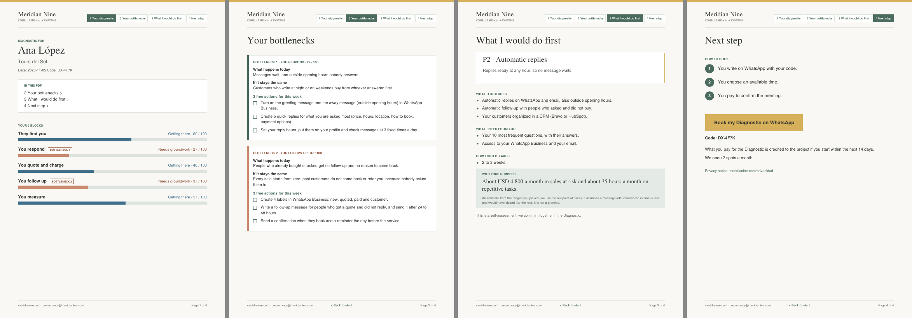

# 01 · Self-serve business diagnostic

**Meridian Nine Consultancy & IA Systems** · B2B lead qualification for an AI consultancy

| Role | Timeline | Status | Links |
|---|---|---|---|
| Strategy, product design, architecture, delivery | 2 working days (≈13 h), including hosting migration | Live since October 2026 | [Landing](https://meridianine.com/consulting.form) · [Demo](https://meridianine.com/diagnosis?demo) |

## Context

The consultancy sells AI-enabled sales and service systems to small businesses in El Salvador and Mexico. Prospects rarely know what they need, and discovery calls are expensive.

## Challenge

Create a free entry point that gives the prospect real value in minutes, qualifies the lead, and brings them to a **paid** diagnostic call already knowing their bottlenecks.

## Approach

1. **Design before build.** Customer journey, 30 statements across 5 business areas, scoring rules, recommendation logic and CRM data model, agreed in a design document.
2. **Prototype.** Clickable bilingual questionnaire in draft mode, refined on mobile.
3. **Infrastructure.** Moved the site from a non-commercial hosting plan to Cloudflare Workers in 7 phases with a rollback plan, keeping DNS and email deliverability intact.
4. **Build behind a switch.** Server-side scoring, private links, transactional emails, PDF report and reminder logic, tested end to end before opening to the public.
5. **Compliance.** Privacy notice under Mexico's 2025 data protection law, separate marketing consent, express consent for business figures.

## Solution

- **Scoring model:** 5 areas scored 0–100; the 2 lowest are the bottlenecks; each bottleneck maps to a service in the offer ladder.
- **Revenue at risk:** an estimate of monthly sales lost to slow replies and hours spent on repetitive tasks, built from optional ranges and clearly labelled as an estimate.
- **Privacy by design:** no personal data in URLs; WhatsApp receives only a short code.
- **Zero marginal cost:** the PDF is generated on the prospect's device; the stack runs on free tiers that allow commercial use.

| Questionnaire | Result |
|---|---|
|  |  |

## Outcomes

- End-to-end funnel live in English and Spanish, from form to booking hand-off.
- 33 automated tests, real end-to-end test with live email before launch.
- Hosting cost: USD 0 on a plan that allows commercial use.
- Deliverability issue found in testing (Gmail Promotions) and fixed before launch.
- Reusable delivery playbook: 12 phases and 20 prompts for future client projects.

## Next

WhatsApp booking agent and online payment (test mode first), then conversion tracking from diagnostic to paid call.

**Stack:** Cloudflare Workers, KV and cron · JavaScript · Brevo (CRM, transactional email) · pdf-lib · GitHub
