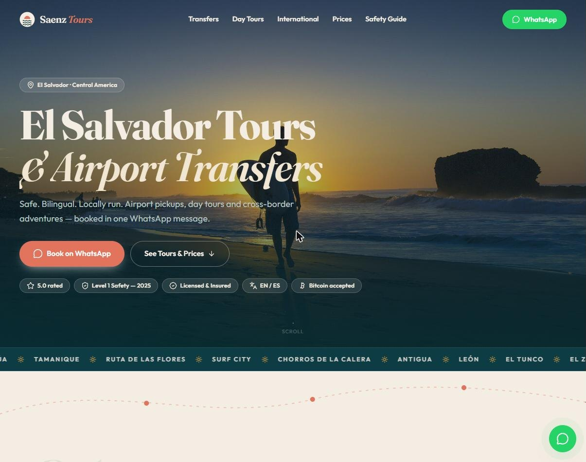
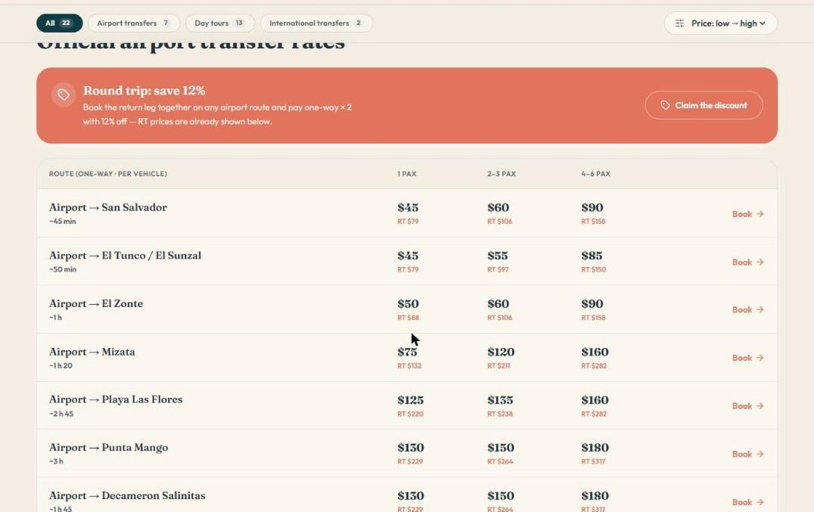
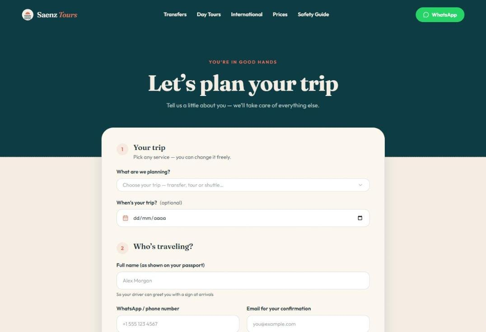
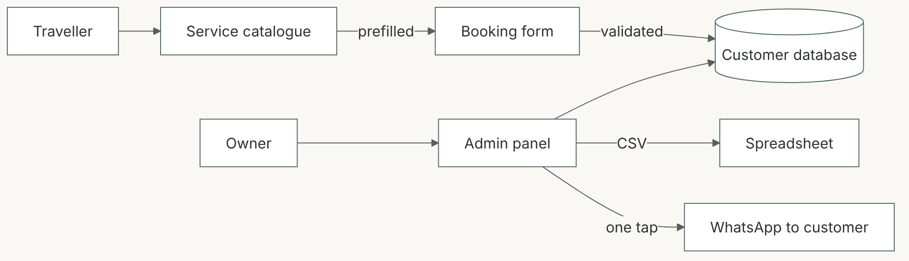

# 02 · Booking platform for a tour operator

**Saenz Tours, El Salvador** · Airport transfers, day tours and international trips for travellers

| Role | Timeline | Status | Links |
|---|---|---|---|
| Consultant: discovery, UX, data model, delivery | 4 working days over 2 calendar weeks | Delivered to the client | [saenztours.com](https://saenztours.com) |

## Context

A local operator serving international travellers and hotels in El Salvador's surf towns. Bookings arrived through scattered messages, often without flight times or accommodation details, and there was no customer list.

## Challenge

Give travellers one clear place to see prices and book, collect everything the driver needs on first contact, and give the owner a customer database without adding work.

## Approach

1. **Discovery with the owner:** services, routes, pricing rules and the questions drivers always had to ask.
2. **Information architecture:** 22 services in 3 categories (airport transfers, day tours, international), transparent "from" prices and a 12% round-trip rule.
3. **Booking flow:** form prefilled from the service chosen; validation on the server.
4. **Operations:** admin view with export to spreadsheet, and one-tap WhatsApp to each customer.
5. **Delivery:** deployment, handover and content updates within the client's timeline.

## Solution

| Prices up front | Booking in two minutes |
|---|---|
|  |  |

- **Complete trip data on first contact:** passengers, flight, luggage, surfboards, accommodation, notes.
- **Consent done right:** booking consent required; marketing opt-in separate and optional.
- **Trust signals for foreign travellers:** bilingual site, safety guide, reviews, licence and insurance, Bitcoin accepted.

## Outcomes

- One booking channel with structured data instead of free-form chats.
- Customer database owned by the client, exportable at any time.
- Delivered in 4 working days; the calendar time was driven by client content and meetings.

**Stack:** React, TypeScript · tRPC with schema validation · MySQL · Docker on Railway

Shared with the client's permission.
