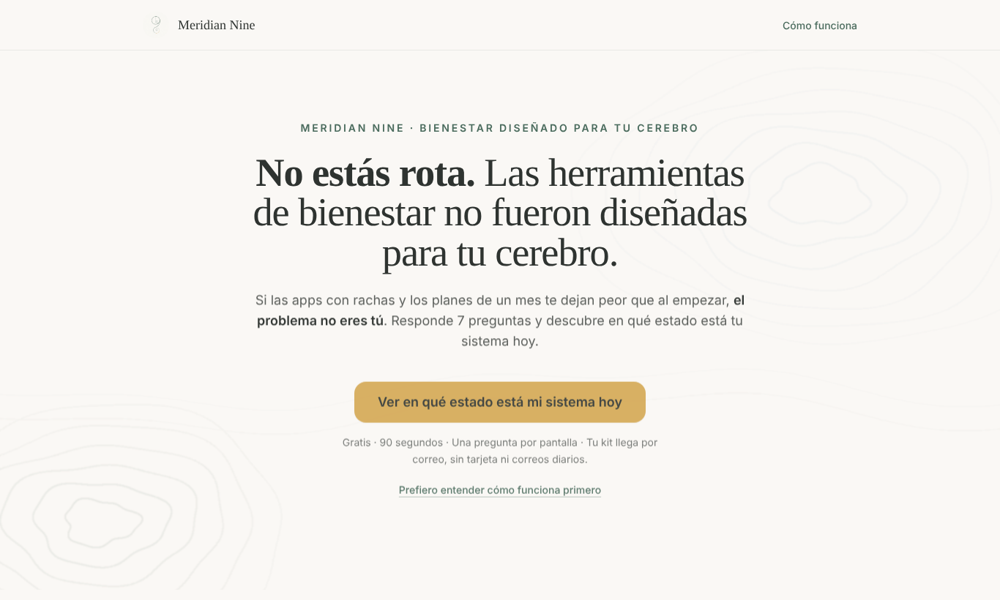
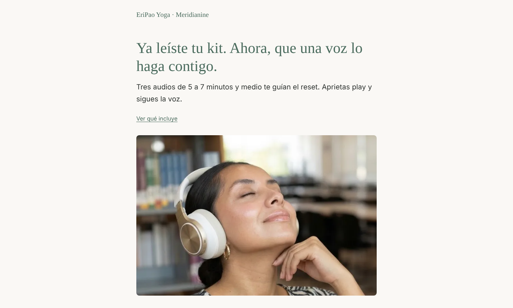
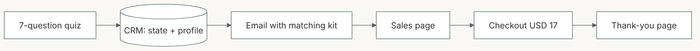
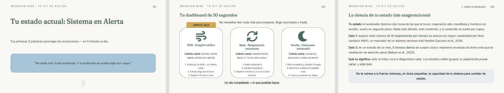

# 03 · Quiz funnel with a paid upsell

**Meridianine (EriPao Yoga · Meridianine)** · B2C wellness brand for neurodivergent adults

| Role | Timeline | Status | Links |
|---|---|---|---|
| Brand funnel strategy, content, CRM automation, pages | October 2026 | Live | [Quiz](https://meridianine.com) · [Upsell page](https://meridianine.com/kit) |

| Entry quiz | Upsell page |
|---|---|
|  |  |

## Context

Mainstream wellness apps rely on streaks and 30-day plans that many neurodivergent people abandon. The brand needed a first step that feels personal and a path to a first purchase without pressure tactics.

## Challenge

Segment visitors in seconds, deliver a free resource matched to their state, and convert a share of them into a low-ticket product.

## Approach

1. **Segmentation:** a 7-question quiz (about 90 seconds) assigns one of 4 nervous-system states.
2. **Lead magnet:** a 9-page visual kit per state, delivered by email.
3. **Automation:** one CRM automation with 4 branches, keyed to the state stored on the contact.
4. **Upsell:** 3 guided audios at USD 17, linked from the kit and from a dedicated sales page with an interactive state selector.
5. **Ethics:** no countdowns, no invented testimonials, no autoplay; copy written for an intuitive, sensitive audience.

## Solution

## Outcomes

- Full funnel live: quiz → segmented list → automated delivery → upsell → checkout.
- Quiz integration moved from a no-code webhook to a direct, server-side CRM connection, keeping keys off the browser.
- Same infrastructure and CRM as Case 01, so leads from both brands live in one system.

**Stack:** HTML, CSS, JavaScript · Cloudflare Workers · Brevo (lists, attributes, automations) · Hotmart
